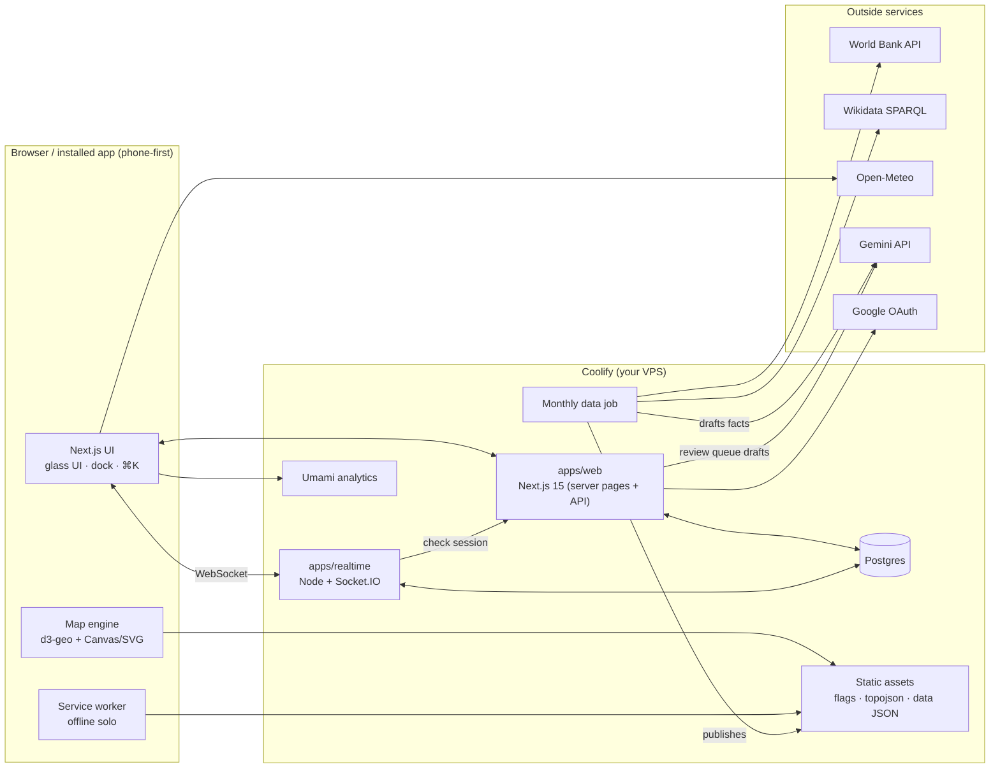
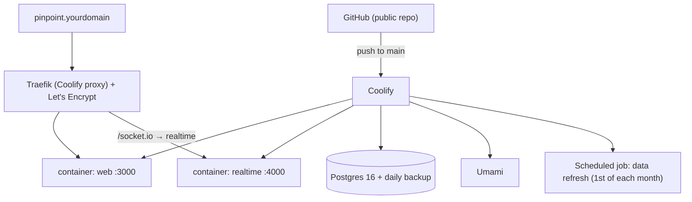

# 2. HLD — High-Level Design

## 2.1 Architecture diagram

## 2.2 Components
| Component | Responsibility | Tech |
|---|---|---|
| `apps/web` | Pages, SEO country pages, Auth.js, REST/server actions (profiles, scores, leaderboards, submissions), admin queue, PWA | Next.js 15, React 19, Tailwind 4, Framer Motion |
| `apps/realtime` | Room lifecycle, voting, round timers, answer collection, server-side scoring, chat, reconnects | Node 22, Socket.IO 4, shared `packages/game` |
| `packages/game` | Question generators, seeded random numbers, answer matching, scoring, scopes | Pure TypeScript, unit-tested |
| `packages/data` | Fetch → normalize → check → publish versioned JSON with a source per value | Node scripts |
| `packages/db` | Schema, migrations, queries | Drizzle ORM + Postgres 16 |
| `packages/ui` | Clay design system (ClaySurface, ClayButton, Dock, Palette, Sheet, Tabs, Avatar, Map components) | React |

## 2.3 Key design choices
1. **Static data, live game state.** Country facts change monthly, so they are published as versioned JSON (`/data/v2026.11/…`), cached forever and stored offline. Postgres holds only user and game data.
2. **A separate realtime service.** Next.js isn't built for long-lived websockets, so Socket.IO runs in its own container. Room state lives in memory, which is enough for a single instance; Redis is only needed if rooms ever span several servers.
3. **Scoring happens on the server** for ranked play, using the same `packages/game` code. Clients only show results.
4. **Seeded questions:** `seed = hash(mode, scope, difficulty, date or room id)`, so the daily puzzle and friend challenges can be reproduced exactly.
5. **Map rendering:** SVG with flag patterns for Flags mode, and Canvas for the data map and year animation so it stays fast. A d3-zoom transform is shared between them.
6. **Sources are first-class:** every value is stored as `{v, year, src}`, and the panel turns `src` into a link.

## 2.4 Deployment diagram

---
