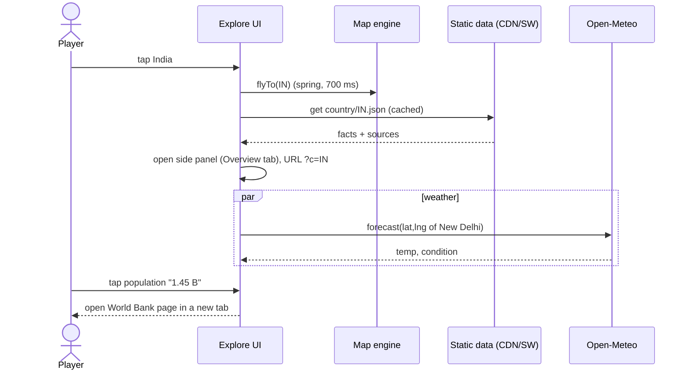
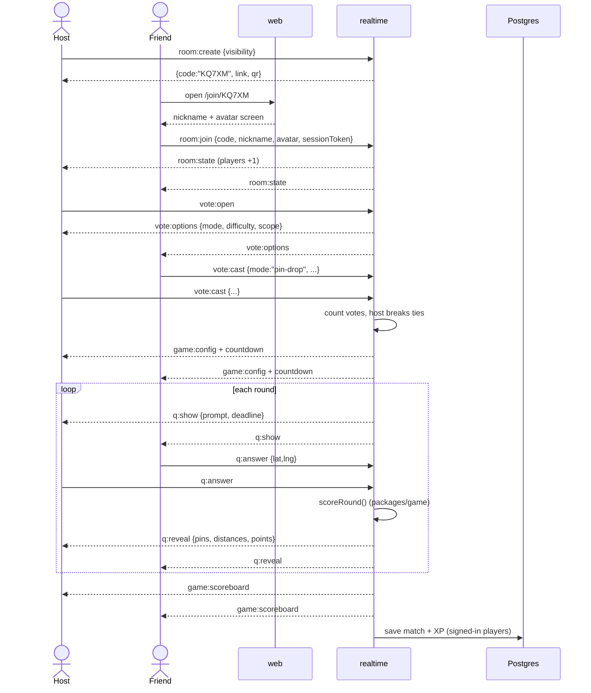
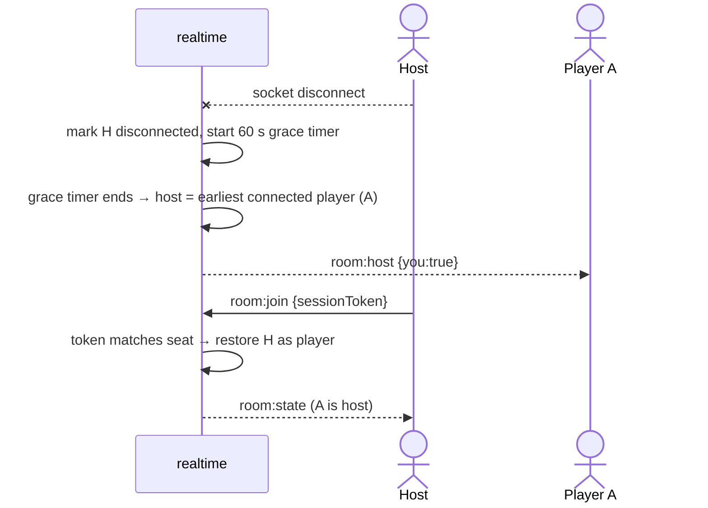
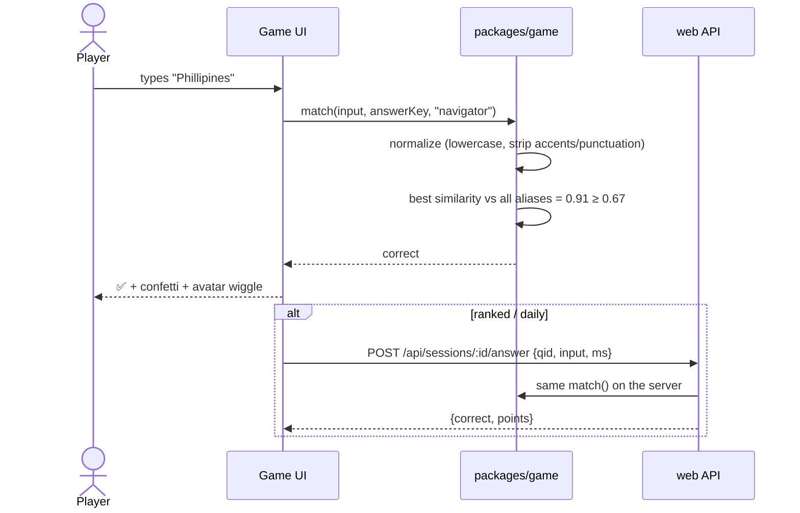
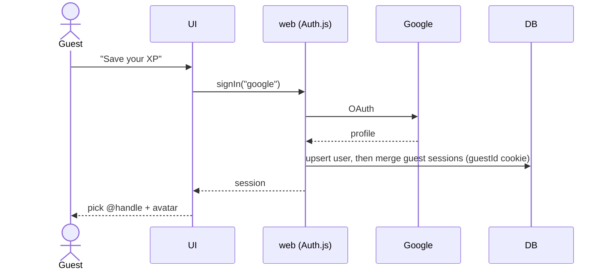
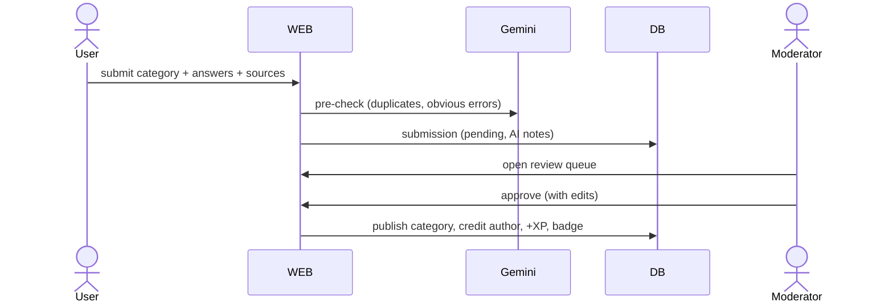

# 4. Sequence diagrams

## 4.1 Explore: tap a country


## 4.2 Party: create, join, vote, play


## 4.3 Host leaves and reconnects


## 4.4 Solo answer with the difficulty rules


## 4.5 Sign-in (guest → account, XP kept)


## 4.6 Monthly data refresh
```mermaid
sequenceDiagram
  participant J as Data job
  participant WB as World Bank
  participant WD as Wikidata
  participant GEM as Gemini
  participant CDN as Static data
  J->>WB: indicators × years
  J->>WD: SPARQL (capital, website, cities, gov type…)
  J->>J: normalize → attach {v, year, src}
  J->>J: check (every country has flag, shape, 12 layers; no NaN)
  alt new countries missing facts
    J->>GEM: draft flag meaning / fun facts with sources
    J->>J: add to review queue (not published until approved)
  end
  J->>CDN: publish /data/v2026.12/ + update manifest
```

## 4.7 Community submission (v2)


---
